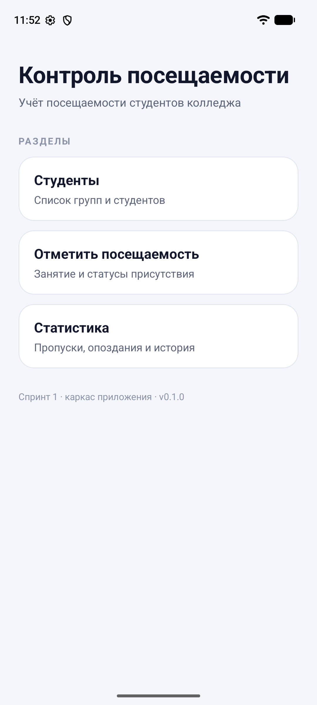
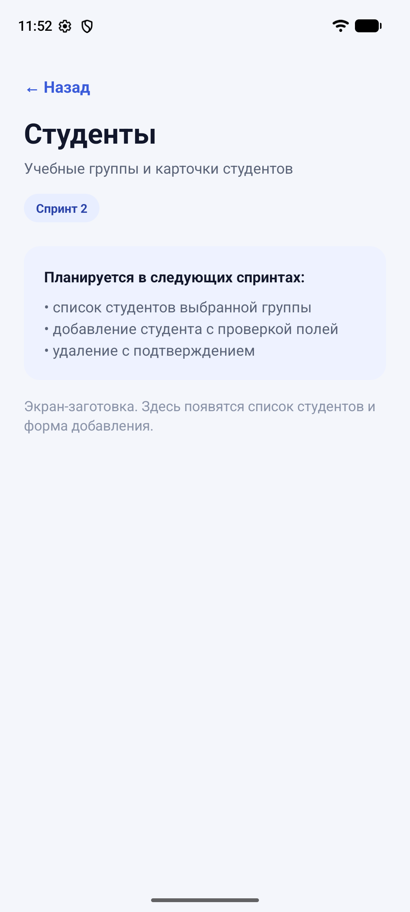

# Протокол демонстрации — Спринт 1

**Проект:** «Система контроля посещаемости студентов»
**Спринт:** 1 (День 1) — «Проектируем систему и создаём основу приложения»
**Дата:** 16.11.2026
**Место:** учебная аудитория, эмулятор Android Studio
**Сборка:** `app-debug.apk`, `versionName 0.1.0-sprint1`

## Участники

| Роль | Участник | Что демонстрирует |
|---|---|---|
| Product Owner | Крытченко Максим | Требования, User Stories, приёмку результата |
| Lead Developer | Чепурнов Дмитрий | Проект, экраны, структуру приложения |
| QA / DevOps | Кургачёв Егор | Тест-кейсы, прогон, сборку и репозиторий |

## Цель демонстрации

Подтвердить, что результат спринта соответствует Definition of Done: приложение запускается,
стартовый экран отображается, основные сценарии описаны, проект находится в Git,
у каждого участника есть коммиты.

## Сценарий демонстрации

| № | Действие | Ожидаемый результат | Фактический результат | Статус |
|---|---|---|---|---|
| 1 | Запустить приложение на эмуляторе | Открывается главный экран, ошибок нет | Холодный старт 1,86 с, открылся `MainActivity` | ✅ |
| 2 | Проверить содержимое главного экрана | Видны название, подзаголовок, три раздела, подпись версии | Все элементы на месте, не перекрыты системными панелями | ✅ |
| 3 | Нажать «Студенты» | Открывается экран «Студенты» с описанием будущих функций | Открылся `StudentsActivity`, заголовок и бейдж «Спринт 2» | ✅ |
| 4 | Нажать «Назад» | Возврат на главный экран | Возврат выполнен | ✅ |
| 5 | Нажать «Отметить посещаемость» | Открывается соответствующий экран | Открылся `AttendanceActivity`, бейдж «Спринт 3» | ✅ |
| 6 | Нажать «Статистика» | Открывается экран статистики | Открылся `StatisticsActivity`, бейдж «Спринт 5» | ✅ |
| 7 | Вернуться на главный экран | Приложение работает, падений нет | `logcat`: 0 аварийных завершений | ✅ |

## Скриншоты

| Главное меню | Студенты | Отметка | Статистика |
|---|---|---|---|
|  |  |  |  |

## Соответствие User Stories

| История | Как проверяли | Итог |
|---|---|---|
| US-01. Навигация по разделам | Шаги 1–7 сценария | ✅ принята |
| US-02 … US-10 | Запланированы на спринты 2–5, в демонстрацию не входят | ⬜ в бэклоге |

## Замечания и решения

| № | Замечание | Решение | Статус |
|---|---|---|---|
| 1 | На экранах-заготовках кнопка «Назад» перекрывалась строкой состояния (DEF-01) | Добавлены системные отступы (`fitsSystemWindows`), выполнена повторная проверка | закрыто до демонстрации |
| 2 | Экраны-заготовки пока не содержат функций | По плану: списки — спринт 2, отметка — спринт 3, статистика — спринт 5 | принято |
| 3 | Данные не сохраняются между запусками | Room подключается на спринте 4; ограничение зафиксировано в README | принято |

## Решение о приёмке

Спринт 1 принят. Все пункты Definition of Done выполнены:

- [x] приложение собирается и запускается на эмуляторе;
- [x] стартовый экран отображается и соответствует макету-описанию;
- [x] переходы между разделами работают, приложение не падает;
- [x] составлено 10 User Stories с критериями приёмки (требовалось не менее 6);
- [x] подготовлены 3 тест-кейса, прогон 3/3;
- [x] проект в Git, есть коммиты PO, LD и QA;
- [x] документация обновлена: README, требования, журнал спринта.

## Подписи

| Роль | Участник | Подпись / отметка о согласии |
|---|---|---|
| Product Owner | Крытченко Максим | согласовано 16.11.2026 |
| Lead Developer | Чепурнов Дмитрий | согласовано 16.11.2026 |
| QA / DevOps | Кургачёв Егор | согласовано 16.11.2026 |
