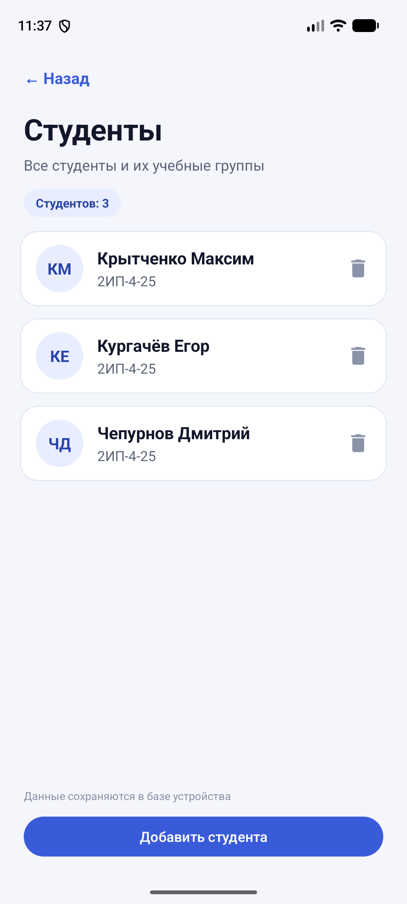
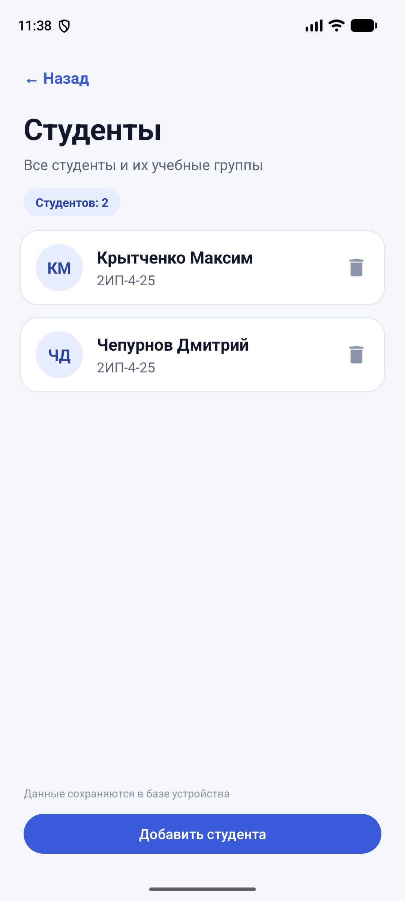
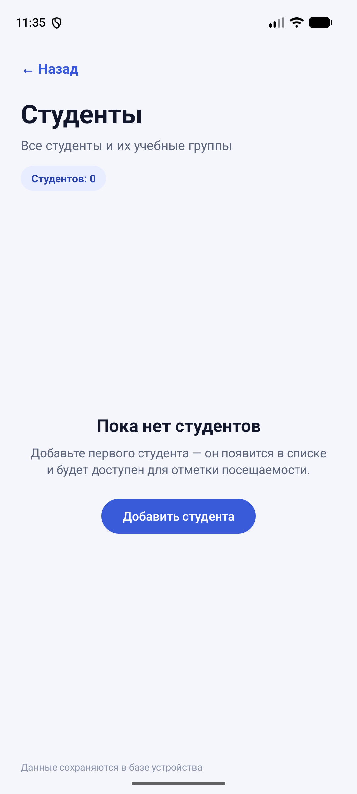
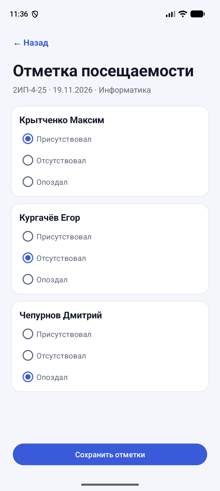
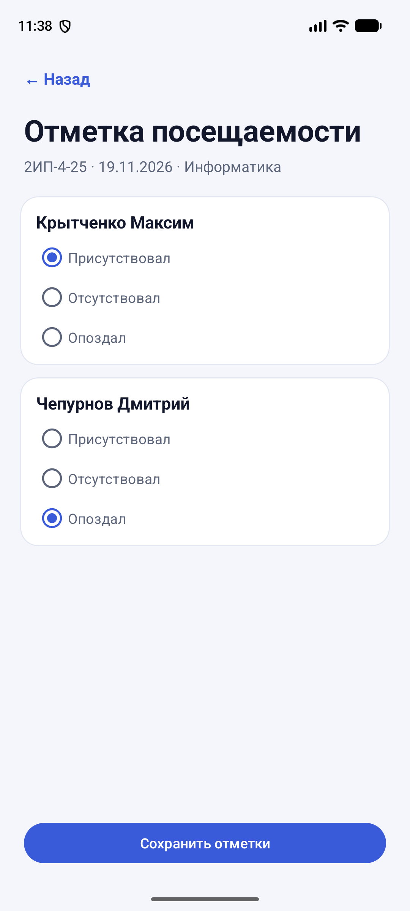

# AttendanceControl — система контроля посещаемости студентов

Учебный командный проект: Android-приложение для преподавателя колледжа, которое помогает
вести список студентов, отмечать посещаемость занятий и смотреть статистику.

**Текущий статус:** Спринт 4 завершён — студенты и отметки сохраняются в локальной базе Room
и не пропадают после перезапуска приложения. Осталась статистика и история (спринт 5).



## Команда и роли (спринт 4)

| Участник | Роль в спринте 4 |
|---|---|
| Крытченко Максим | Product Owner: правила хранения, сущности, поведение пустой базы |
| Чепурнов Дмитрий | Lead Developer: Room, Entity, DAO, `AppDatabase`, перевод экранов на базу |
| Кургачёв Егор | QA / DevOps: проверки сохранения, перезапуска и удаления, сборка |

Ротация ролей по дням описана в [docs/ROLES.md](docs/ROLES.md).

## Технологии

- **Kotlin** — весь код приложения;
- **Android Studio / Gradle 9.6.0 / AGP 9.4.1**;
- **XML + Activity** (`AppCompatActivity`), без Compose;
- **AndroidX AppCompat, Material Components 1.12.0, RecyclerView 1.3.2, Lifecycle KTX**;
- **Room 2.8.5 (SQLite) + KSP** — локальное хранение студентов и отметок;
- **JUnit 4** — для модульных проверок логики;
- **Git** — ветки на задачи, коммиты каждого участника, слияние в `main`;
- **Markdown** — документация.

## Требования к окружению

| Компонент | Версия |
|---|---|
| Android Studio | любая актуальная (проверено на AGP 9.4.1) |
| JDK | 17+ (в Android Studio используется встроенный JBR) |
| Android SDK | Platform 37, Build-Tools 36.0.0 |
| Gradle | 9.6.0 (через wrapper) |
| minSdk / targetSdk | 24 / 37 |

## Как открыть и запустить

1. Открыть папку проекта `AttendanceControl` в Android Studio (**Open** → выбрать папку с `settings.gradle.kts`).
2. Дождаться синхронизации Gradle (первый запуск скачивает зависимости из сети).
3. Создать `local.properties` с путём к SDK, если файла нет:
   ```properties
   sdk.dir=C\:\\Users\\<пользователь>\\AppData\\Local\\Android\\Sdk
   ```
   Файл добавлен в `.gitignore` и в репозиторий не попадает.
4. Запустить конфигурацию `app` на эмуляторе или устройстве (кнопка **Run**).

### Сборка и установка из командной строки

```powershell
# debug-сборка
.\gradlew.bat assembleDebug

# APK появится здесь:
# app\build\outputs\apk\debug\app-debug.apk

# установка на подключённый эмулятор/устройство
adb install -r app\build\outputs\apk\debug\app-debug.apk

# запуск
adb shell am start -n ru.college.attendance/.MainActivity
```

## Структура проекта

```
AttendanceControl/
├── app/src/main/
│   ├── java/ru/college/attendance/
│   │   ├── AttendanceApplication.kt     # инициализация Room и репозиториев
│   │   ├── MainActivity.kt              # главный экран и навигация
│   │   ├── data/
│   │   │   ├── Student.kt               # модель студента
│   │   │   ├── Attendance.kt            # модель отметки и статусы
│   │   │   ├── StudentRepository.kt     # операции со студентами через DAO
│   │   │   ├── AttendanceRepository.kt  # операции с отметками через DAO
│   │   │   └── database/
│   │   │       ├── StudentEntity.kt     # таблица students
│   │   │       ├── AttendanceEntity.kt  # таблица attendance, уникальный индекс и внешний ключ
│   │   │       ├── StudentDao.kt        # запросы по студентам
│   │   │       ├── AttendanceDao.kt     # запросы по отметкам
│   │   │       └── AppDatabase.kt       # база и её единственный экземпляр
│   │   └── ui/
│   │       ├── StudentsActivity.kt      # список студентов
│   │       ├── AddStudentActivity.kt    # форма добавления с проверкой полей
│   │       ├── StudentAdapter.kt        # адаптер списка студентов
│   │       ├── LessonActivity.kt        # экран занятия: группа, дата, дисциплина
│   │       ├── AttendanceActivity.kt    # экран отметки посещаемости
│   │       ├── AttendanceAdapter.kt     # карточки студентов со статусами
│   │       └── StatisticsActivity.kt    # заготовка: статистика (спринт 5)
│   ├── res/
│   │   ├── layout/                      # экраны, формы и карточки
│   │   ├── values/                      # строки, цвета, тема и стили
│   │   └── drawable/                    # фон карточек, бейдж, иконка, корзина
│   └── AndroidManifest.xml
├── docs/
│   ├── REQUIREMENTS.md                  # проблема, границы, экраны, модель данных
│   ├── STUDENT_INPUT_SPEC.md            # поля, правила ввода и тексты ошибок
│   ├── ATTENDANCE_SPEC.md               # сценарий занятия, статусы и правила отметки
│   ├── STORAGE_SPEC.md                  # что и как хранится в Room
│   └── ROLES.md                         # роли, ротация и передача смены
├── screenshots/                         # скриншоты и дампы UI для тест-кейсов
├── USER_STORIES.md                      # 10 историй с критериями приёмки
├── TEST_CASES.md                        # тест-кейсы и результаты прогонов
├── SPRINT_JOURNAL.md                    # журнал спринтов
├── DEMO_PROTOCOL.md                     # протоколы демонстрации
└── README.md
```

## Экраны

| Экран | Activity | Состояние |
|---|---|---|
| Главное меню | `MainActivity` | ✅ работает: название и три перехода |
| Студенты | `StudentsActivity` | ✅ список из базы, счётчик, пустое состояние, удаление |
| Новый студент | `AddStudentActivity` | ✅ форма с проверкой полей и дубликатов |
| Занятие | `LessonActivity` | ✅ группа, дата, дисциплина; сообщение при отсутствии студентов |
| Отметка посещаемости | `AttendanceActivity` | ✅ статусы для каждого студента, сохранение в базу |
| Статистика | `StatisticsActivity` | 🧩 заготовка (спринт 5) |

| Список после перезапуска | Отметки после перезапуска | Удаление студента |
|---|---|---|
|  |  |  |

| Пустая база | Отметки до перезапуска | Каскадное удаление |
|---|---|---|
|  |  |  |

## Что уже проверено

- сборка `assembleDebug` проходит (Room + KSP), приложение запускается на эмуляторе Android 17 (API 37);
- TC-01 … TC-03 (спринт 1), TC-05 … TC-11 (спринт 2), TC-04 и TC-12 … TC-17 (спринт 3),
  TC-20 … TC-22 (спринт 4) — **20 из 20 пройдены**;
- данные сохраняются между запусками: студенты и отметки остаются после `force-stop`;
- первый запуск на пустой базе не приводит к ошибкам;
- удаление студента каскадно удаляет его отметки;
- повторное добавление студента отклоняется и после перехода на Room;
- аварийных завершений приложения нет.

Подробности — в [TEST_CASES.md](TEST_CASES.md) и [DEMO_PROTOCOL.md](DEMO_PROTOCOL.md).

## Ограничения текущей версии

- база хранится только на одном устройстве, без синхронизации и резервного копирования;
- отдельного списка занятий нет: к отметкам возвращаются повторным вводом группы, даты и дисциплины;
- студента можно добавить и удалить, но нельзя отредактировать;
- статистика и история посещаемости — спринт 5;
- приложение рассчитано на одного пользователя, без сети и авторизации.

## Документация

- [Требования и границы проекта](docs/REQUIREMENTS.md)
- [Правила ввода студента и тексты ошибок](docs/STUDENT_INPUT_SPEC.md)
- [Сценарий занятия и правила отметки](docs/ATTENDANCE_SPEC.md)
- [Хранение данных в Room](docs/STORAGE_SPEC.md)
- [User Stories и критерии приёмки](USER_STORIES.md)
- [Тест-кейсы и результаты](TEST_CASES.md)
- [Журнал спринтов](SPRINT_JOURNAL.md)
- [Протоколы демонстрации](DEMO_PROTOCOL.md)
- [Роли, ротация и передача смены](docs/ROLES.md)

## Работа с Git

- `main` — рабочая версия; задачи выполняются в ветках `feature/...`, `fix/...`, `docs/...`, `test/...`;
- перед слиянием другой участник проверяет, что проект собирается;
- сообщения коммитов описывают изменение: `feat(ld): ...`, `fix(ld): ...`, `docs(po): ...`, `test(qa): ...`;
- теги версий: `v0.1.0-sprint1`, `v0.2.0-sprint2`, `v0.3.0-sprint3`, `v0.4.0-sprint4`.

## План на спринт 5

1. Экран истории посещаемости с фильтрами по студенту и группе.
2. Статистика: занятия, присутствия, пропуски и опоздания.
3. Обработка пустой истории и больших списков.
4. Тест-кейсы TC-18, TC-19 и регрессионный прогон TC-01 … TC-22.
5. Ротация ролей: PO — Кургачёв Егор, LD — Крытченко Максим, QA — Чепурнов Дмитрий.
