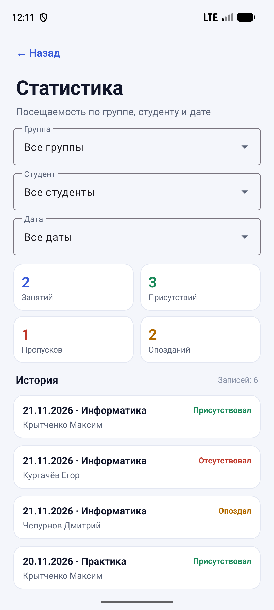
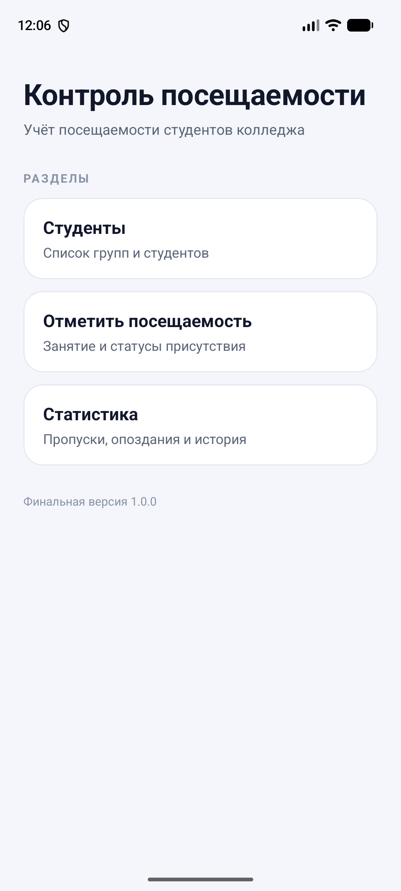

# AttendanceControl — система контроля посещаемости студентов

Учебный командный проект: Android-приложение для преподавателя колледжа, которое помогает
вести список студентов, отмечать посещаемость занятий и смотреть статистику.

**Статус:** проект сдан, версия **1.0.0**. Приложение собирается, устанавливается на чистом
эмуляторе, проводит полный сценарий от добавления студентов до статистики и сохраняет данные
между запусками.



## Команда и роли (спринт 6)

| Участник | Роль в спринте 6 |
|---|---|
| Чепурнов Дмитрий | Product Owner: приёмка, сценарий демонстрации, итоговые документы |
| Кургачёв Егор | Lead Developer: финальная сборка, архитектура, демонстрация функций |
| Крытченко Максим | QA / DevOps: финальная регрессия, чистый эмулятор, итоговый отчёт |

Роли по всем шести спринтам и передача смены — в [docs/ROLES.md](docs/ROLES.md).
Личный вклад участников — в [docs/INDIVIDUAL_REPORTS.md](docs/INDIVIDUAL_REPORTS.md).

## Возможности

- список студентов группы: добавление с проверкой полей, удаление с подтверждением;
- занятие: группа, дата и дисциплина, переход к отметке;
- отметка посещаемости: «Присутствовал», «Отсутствовал», «Опоздал» для каждого студента;
- одна отметка на студента и занятие, повторное сохранение заменяет статус;
- статистика: занятия, присутствия, пропуски и опоздания;
- история отметок с фильтрами по группе, студенту и дате;
- постоянное хранение в Room: данные не пропадают после перезапуска.

## Технологии

- **Kotlin**, **Android Studio**, **Gradle 9.6.0**, **AGP 9.4.1**;
- **XML + Activity** (`AppCompatActivity`), без Compose;
- **AndroidX AppCompat, Material Components 1.12.0, RecyclerView, Lifecycle KTX**;
- **Room 2.8.5 (SQLite) + KSP**;
- **JUnit 4**, **Git**, **Markdown**.

## Требования к окружению

| Компонент | Версия |
|---|---|
| Android Studio | любая актуальная (проверено на AGP 9.4.1) |
| JDK | 17+ (в Android Studio используется встроенный JBR) |
| Android SDK | Platform 37, Build-Tools 36.0.0 |
| Gradle | 9.6.0 (через wrapper) |
| minSdk / targetSdk | 24 / 37 |

## Как открыть и запустить

1. Открыть папку проекта `AttendanceControl` в Android Studio (**Open** → выбрать папку с `settings.gradle.kts`).
2. Дождаться синхронизации Gradle (первый запуск скачивает зависимости из сети).
3. Создать `local.properties` с путём к SDK, если файла нет:
   ```properties
   sdk.dir=C\:\\Users\\<пользователь>\\AppData\\Local\\Android\\Sdk
   ```
   Файл добавлен в `.gitignore` и в репозиторий не попадает.
4. Запустить конфигурацию `app` на эмуляторе или устройстве (кнопка **Run**).

### Сборка и установка из командной строки

```powershell
.\gradlew.bat assembleDebug
adb install -r app\build\outputs\apk\debug\app-debug.apk
adb shell am start -n ru.college.attendance/.MainActivity
```

## Структура проекта

```
AttendanceControl/
├── app/src/main/
│   ├── java/ru/college/attendance/
│   │   ├── AttendanceApplication.kt     # инициализация Room и репозиториев
│   │   ├── MainActivity.kt              # главный экран и навигация
│   │   ├── data/
│   │   │   ├── Student.kt               # модель студента
│   │   │   ├── Attendance.kt            # модель отметки и статусы
│   │   │   ├── HistoryRecord.kt         # строка истории для статистики
│   │   │   ├── StudentRepository.kt     # операции со студентами через DAO
│   │   │   ├── AttendanceRepository.kt  # операции с отметками через DAO
│   │   │   └── database/
│   │   │       ├── StudentEntity.kt     # таблица students
│   │   │       ├── AttendanceEntity.kt  # таблица attendance, уникальный индекс и внешний ключ
│   │   │       ├── StudentDao.kt        # запросы по студентам
│   │   │       ├── AttendanceDao.kt     # запросы по отметкам
│   │   │       └── AppDatabase.kt       # база и её единственный экземпляр
│   │   └── ui/
│   │       ├── StudentsActivity.kt      # список студентов
│   │       ├── AddStudentActivity.kt    # форма добавления с проверкой полей
│   │       ├── StudentAdapter.kt        # адаптер списка студентов
│   │       ├── LessonActivity.kt        # экран занятия: группа, дата, дисциплина
│   │       ├── AttendanceActivity.kt    # экран отметки посещаемости
│   │       ├── AttendanceAdapter.kt     # карточки студентов со статусами
│   │       ├── StatisticsActivity.kt    # статистика, история и фильтры
│   │       └── HistoryAdapter.kt        # адаптер истории посещаемости
│   ├── res/                             # разметка, строки, цвета, тема, иконки
│   └── AndroidManifest.xml
├── docs/
│   ├── REQUIREMENTS.md                  # проблема, границы, экраны, модель данных
│   ├── STUDENT_INPUT_SPEC.md            # поля, правила ввода и тексты ошибок
│   ├── ATTENDANCE_SPEC.md               # сценарий занятия, статусы и правила отметки
│   ├── STORAGE_SPEC.md                  # что и как хранится в Room
│   ├── STATISTICS_SPEC.md               # показатели, фильтры и пустые состояния
│   ├── USER_GUIDE.md                    # инструкция пользователя
│   ├── DEFECTS.md                       # отчёт о дефектах
│   ├── ARCHITECTURE.md                  # структура приложения и схема базы
│   ├── QA_REPORT.md                     # итоговый отчёт QA
│   ├── INDIVIDUAL_REPORTS.md            # индивидуальные отчёты участников
│   └── ROLES.md                         # роли, ротация и передача смены
├── reports/                             # Word-отчёты по дням и итоговые отчёты
├── screenshots/                         # скриншоты и дампы UI
├── USER_STORIES.md                      # 10 историй с критериями приёмки
├── TEST_CASES.md                        # 25 тест-кейсов и результаты
├── SPRINT_JOURNAL.md                    # журнал шести спринтов
├── DEMO_PROTOCOL.md                     # протоколы демонстрации
└── README.md
```

## Экраны

| Экран | Activity | Состояние |
|---|---|---|
| Главное меню | `MainActivity` | ✅ три перехода |
| Студенты | `StudentsActivity` | ✅ список из базы, счётчик, удаление |
| Новый студент | `AddStudentActivity` | ✅ проверка полей и дубликатов |
| Занятие | `LessonActivity` | ✅ группа, дата, дисциплина |
| Отметка посещаемости | `AttendanceActivity` | ✅ три статуса, сохранение в базу |
| Статистика | `StatisticsActivity` | ✅ показатели, история, фильтры |

| Главный экран | Студенты после перезапуска | Отметки после перезапуска |
|---|---|---|
|  |  |  |

## Проверки

- **25 из 25 тест-кейсов** пройдены на эмуляторе Android 17 (API 37);
- финальная регрессия TC-01…TC-23 после сдачи спринта 5 — без замечаний;
- сквозной сценарий TC-24: чистая установка → студенты → два занятия → статистика;
- TC-25: `force-stop` и повторный запуск — студенты, отметки и статистика сохраняются;
- статистика совпадает с тестовыми данными: 2 занятия, 3 присутствия, 1 пропуск, 2 опоздания;
- сборка `assembleDebug` проходит, в том числе из чистого клона репозитория;
- открытых дефектов нет ([docs/DEFECTS.md](docs/DEFECTS.md)).

Подробности — в [TEST_CASES.md](TEST_CASES.md) и [docs/QA_REPORT.md](docs/QA_REPORT.md).

## Ограничения

- данные хранятся только на одном устройстве, без синхронизации и резервных копий;
- отдельного списка занятий нет: к отметкам возвращаются вводом группы, даты и дисциплины;
- студента можно добавить и удалить, но нельзя отредактировать;
- графиков, экспорта и отчётов нет;
- приложение работает без сети и авторизации.

## Документация

- [Требования](docs/REQUIREMENTS.md)
- [Правила ввода студента](docs/STUDENT_INPUT_SPEC.md)
- [Сценарий занятия и статусы](docs/ATTENDANCE_SPEC.md)
- [Хранение в Room](docs/STORAGE_SPEC.md)
- [Статистика и фильтры](docs/STATISTICS_SPEC.md)
- [Инструкция пользователя](docs/USER_GUIDE.md)
- [Архитектура и схема базы](docs/ARCHITECTURE.md)
- [Дефекты](docs/DEFECTS.md)
- [Итоговый отчёт QA](docs/QA_REPORT.md)
- [User Stories](USER_STORIES.md)
- [Тест-кейсы](TEST_CASES.md)
- [Журнал спринтов](SPRINT_JOURNAL.md)
- [Протоколы демонстрации](DEMO_PROTOCOL.md)
- [Роли и ротация](docs/ROLES.md)
- [Индивидуальные отчёты](docs/INDIVIDUAL_REPORTS.md)
- [Word-отчёты участников](reports/README.md)

## Демонстрация за 3 минуты

1. «Студенты» → добавить трёх студентов группы 2ИП-4-25.
2. «Отметить посещаемость» → выбрать группу, дату, дисциплину → отметить статусы → сохранить.
3. Повторить для второго занятия с другой датой и дисциплиной.
4. «Статистика» → показать 2/3/1/2 и историю; переключить фильтры.
5. Закрыть приложение и открыть снова → показать сохранённые данные.

## История версий

| Версия | Спринт | Итог |
|---|---|---|
| 0.1.0 | 1 | каркас, главный экран, навигация |
| 0.2.0 | 2 | студенты: список, добавление, удаление |
| 0.3.0 | 3 | занятие, статусы, повторная отметка |
| 0.4.0 | 4 | Room, сохранение между запусками |
| 0.5.0 | 5 | статистика, история, фильтры |
| 1.0.0 | 6 | финальная сборка, регрессия, документация |
| 1.0.1 | 6 | Word-отчёты по дням и итоговые отчёты участников |
