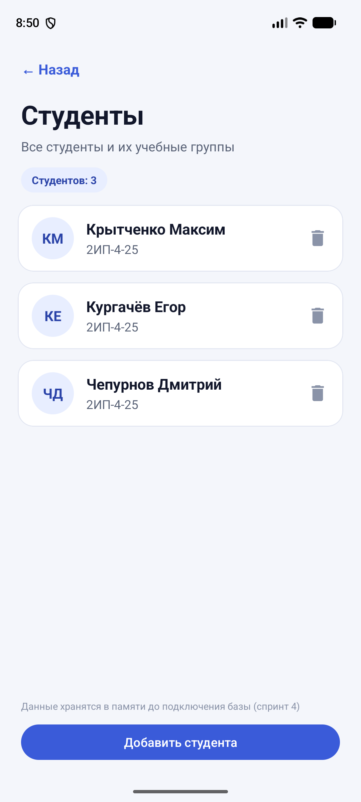
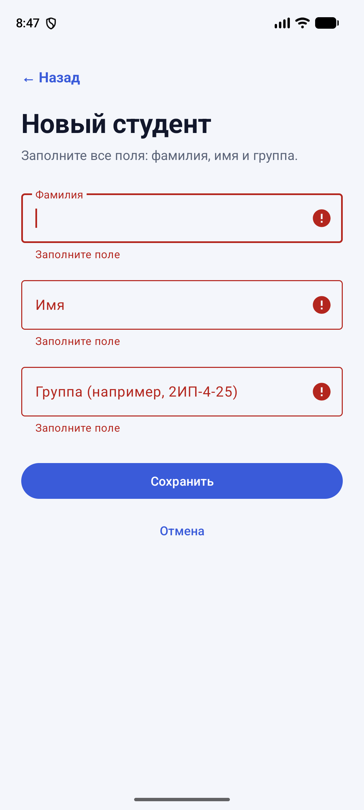
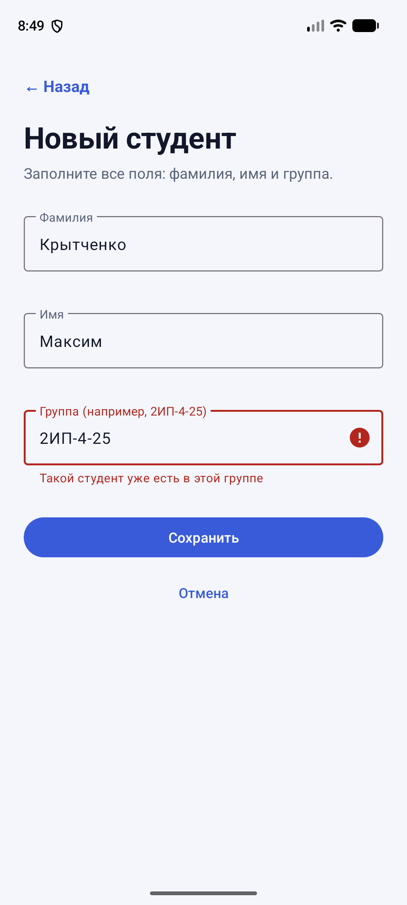

# AttendanceControl — система контроля посещаемости студентов

Учебный командный проект: Android-приложение для преподавателя колледжа, которое помогает
вести список студентов, отмечать посещаемость занятий и смотреть статистику.

**Текущий статус:** Спринт 2 завершён — работает раздел «Студенты»: список группы, форма
добавления с проверкой полей и удаление с подтверждением. Отметка посещаемости и статистика
пока остаются экранами-заготовками.



## Команда и роли (спринт 2)

| Участник | Роль в спринте 2 |
|---|---|
| Крытченко Максим | Lead Developer: модель `Student`, список, форма, удаление |
| Кургачёв Егор | Product Owner: правила ввода, приёмка, журнал |
| Чепурнов Дмитрий | QA / DevOps: тест-кейсы, прогон, скриншоты, сборка |

Ротация ролей по дням описана в [docs/ROLES.md](docs/ROLES.md).

## Технологии

- **Kotlin** — весь код приложения;
- **Android Studio / Gradle 9.6.0 / AGP 9.4.1**;
- **XML + Activity** (`AppCompatActivity`), без Compose;
- **AndroidX AppCompat, Material Components 1.12.0, RecyclerView 1.3.2**;
- **Room (SQLite)** — подключается на спринте 4;
- **JUnit 4** — для модульных проверок логики;
- **Git** — ветки на задачи, коммиты каждого участника, слияние в `main`;
- **Markdown** — документация.

## Требования к окружению

| Компонент | Версия |
|---|---|
| Android Studio | любая актуальная (проверено на AGP 9.4.1) |
| JDK | 17+ (в Android Studio используется встроенный JBR) |
| Android SDK | Platform 37, Build-Tools 36.0.0 |
| Gradle | 9.6.0 (через wrapper) |
| minSdk / targetSdk | 24 / 37 |

## Как открыть и запустить

1. Открыть папку проекта `AttendanceControl` в Android Studio (**Open** → выбрать папку с `settings.gradle.kts`).
2. Дождаться синхронизации Gradle (первый запуск скачивает зависимости из сети).
3. Создать `local.properties` с путём к SDK, если файла нет:
   ```properties
   sdk.dir=C\:\\Users\\<пользователь>\\AppData\\Local\\Android\\Sdk
   ```
   Файл добавлен в `.gitignore` и в репозиторий не попадает.
4. Запустить конфигурацию `app` на эмуляторе или устройстве (кнопка **Run**).

### Сборка и установка из командной строки

```powershell
# debug-сборка
.\gradlew.bat assembleDebug

# APK появится здесь:
# app\build\outputs\apk\debug\app-debug.apk

# установка на подключённый эмулятор/устройство
adb install -r app\build\outputs\apk\debug\app-debug.apk

# запуск
adb shell am start -n ru.college.attendance/.MainActivity
```

## Структура проекта

```
AttendanceControl/
├── app/src/main/
│   ├── java/ru/college/attendance/
│   │   ├── MainActivity.kt              # главный экран и навигация
│   │   ├── data/
│   │   │   ├── Student.kt               # модель студента
│   │   │   └── StudentRepository.kt     # временное хранилище в памяти (Room — спринт 4)
│   │   └── ui/
│   │       ├── StudentsActivity.kt      # список студентов
│   │       ├── AddStudentActivity.kt    # форма добавления с проверкой полей
│   │       ├── StudentAdapter.kt        # RecyclerView-адаптер
│   │       ├── AttendanceActivity.kt    # заготовка: отметка (спринт 3)
│   │       └── StatisticsActivity.kt    # заготовка: статистика (спринт 5)
│   ├── res/
│   │   ├── layout/                      # экраны, форма и карточка студента
│   │   ├── values/                      # строки, цвета, тема и стили
│   │   └── drawable/                    # фон карточек, бейдж, иконка, корзина
│   └── AndroidManifest.xml
├── docs/
│   ├── REQUIREMENTS.md                  # проблема, границы, экраны, модель данных
│   ├── STUDENT_INPUT_SPEC.md            # поля, правила ввода и тексты ошибок
│   └── ROLES.md                         # роли, ротация и передача смены
├── screenshots/                         # скриншоты и дампы UI для тест-кейсов
├── USER_STORIES.md                      # 10 историй с критериями приёмки
├── TEST_CASES.md                        # тест-кейсы и результаты прогонов
├── SPRINT_JOURNAL.md                    # журнал спринтов
├── DEMO_PROTOCOL.md                     # протоколы демонстрации
└── README.md
```

## Экраны

| Экран | Activity | Состояние |
|---|---|---|
| Главное меню | `MainActivity` | ✅ работает: название и три перехода |
| Студенты | `StudentsActivity` | ✅ список, счётчик, пустое состояние, удаление |
| Новый студент | `AddStudentActivity` | ✅ форма с проверкой полей и дубликатов |
| Отметка посещаемости | `AttendanceActivity` | 🧩 заготовка (спринт 3) |
| Статистика | `StatisticsActivity` | 🧩 заготовка (спринт 5) |

| Список группы 2ИП-4-25 | Форма добавления | Ошибки валидации |
|---|---|---|
|  |  |  |

| Дубликат | Удаление | После удаления |
|---|---|---|
|  |  |  |

## Что уже проверено

- сборка `assembleDebug` проходит, приложение запускается на эмуляторе Android 17 (API 37);
- TC-01 … TC-03 (спринт 1) и TC-05 … TC-11 (спринт 2) — 10 из 10 пройдены;
- корректный студент добавляется и появляется в списке с сортировкой по фамилии;
- пустые поля, пробелы, длина больше 40 символов и дубликаты отклоняются с понятными ошибками;
- удаление спрашивает подтверждение, счётчик и список обновляются, отмена ничего не меняет;
- аварийных завершений приложения нет.

Подробности — в [TEST_CASES.md](TEST_CASES.md) и [DEMO_PROTOCOL.md](DEMO_PROTOCOL.md).

## Ограничения текущей версии

- данные хранятся **в памяти**: после полного закрытия приложения список студентов очищается
  (постоянное хранение на Room — спринт 4);
- студента можно добавить и удалить, но нельзя отредактировать (перенесено за пределы спринта 2);
- группы вводятся текстом, отдельного справочника групп нет;
- экраны «Отметка посещаемости» и «Статистика» пока без функций;
- приложение рассчитано на одного пользователя и одно устройство, без сети и авторизации.

## Документация

- [Требования и границы проекта](docs/REQUIREMENTS.md)
- [Правила ввода студента и тексты ошибок](docs/STUDENT_INPUT_SPEC.md)
- [User Stories и критерии приёмки](USER_STORIES.md)
- [Тест-кейсы и результаты](TEST_CASES.md)
- [Журнал спринтов](SPRINT_JOURNAL.md)
- [Протоколы демонстрации](DEMO_PROTOCOL.md)
- [Роли, ротация и передача смены](docs/ROLES.md)

## Работа с Git

- `main` — рабочая версия; задачи выполняются в ветках `feature/...`, `fix/...`, `docs/...`, `test/...`;
- перед слиянием другой участник проверяет, что проект собирается;
- сообщения коммитов описывают изменение: `feat(ld): ...`, `fix(ld): ...`, `docs(po): ...`, `test(qa): ...`;
- теги версий: `v0.1.0-sprint1`, `v0.2.0-sprint2`, далее по спринтам.

## План на спринт 3

1. Модель `Lesson` и `Attendance`, экран создания занятия (группа, дата, дисциплина).
2. Список студентов занятия с выбором статуса: «Присутствовал», «Отсутствовал», «Опоздал».
3. Сохранение отметок в текущем сеансе и изменение статуса до сохранения.
4. Тест-кейсы TC-04, TC-12 … TC-16.
5. Ротация ролей: PO — Чепурнов Дмитрий, LD — Кургачёв Егор, QA — Крытченко Максим.
